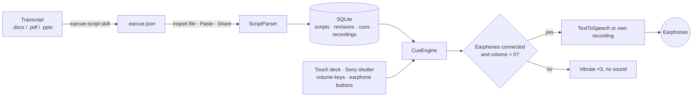

<div align="center">


# EarCue

An Android prompter that reads your speech into your earphones, one line per thumb press.

[Download APK](https://github.com/naritaroad/EarCue/releases/latest) · [Script format](skills/earcue-script/reference/format.md) · [Issues](https://github.com/naritaroad/EarCue/issues)


**English** | [繁體中文](docs/README/README.zh-TW.md) | [简体中文](docs/README/README.zh-CN.md) | [Español](docs/README/README.es.md) | [Português (Brasil)](docs/README/README.pt-BR.md) | [日本語](docs/README/README.ja.md) | [한국어](docs/README/README.ko.md) | [Français](docs/README/README.fr.md) | [Deutsch](docs/README/README.de.md) | [Русский](docs/README/README.ru.md)

</div>

## Features

- **Instant switching**: every press of Next or Previous cuts the current line and starts the new one, so lines never overlap and you never wait for a sentence to finish.
- **Earphone guard**: with no earphones connected, or with media volume at 0, play buttons vibrate three times and make no sound. Unplugging mid-line stops playback.
- **One-thumb control**: three preset button layouts, drag-to-move and drag-to-resize editing with reset, a left/right-hand mirror, and a black Stage mode for a phone held behind your back.
- **Hardware buttons**: Sony shutter button (press = next, hold = previous), optional volume keys, and wired or Bluetooth earphone buttons.
- **Voices**: Android text-to-speech with speed 0.25×–2.00× (hold − or + to change it continuously), pitch, engine and voice choice filtered by region and offline use, word-by-word highlighting, or your own recording per line.
- **Script library**: local SQLite storage with search over titles, tags and text, tag filters, and a git-like history: update a script from a new file and restore any earlier revision.
- **AI conversion skill**: `skills/earcue-script` turns a Word, PDF or slide transcript into a tagged `.earcue.json` file and checks it word for word against the source.
- **10 UI languages**: with light and dark themes: English, 繁體中文, 简体中文, Español, Português (Brasil), 日本語, 한국어, Français, Deutsch, Русский.

## Demo

<p align="center">
  
  
  
  
  
</p>

Try it with the fictional sample talk in [`examples/green-streets/`](examples/green-streets/): a slide deck, a bilingual transcript, and the converted cue file for presenter P2.

## Architecture



Every import becomes a revision of a script, and the current revision is expanded into cues. `CueEngine` owns playback: it flushes the previous utterance before starting the next one and checks the audio output on every press. Details: [docs/architecture.md](docs/architecture.md)

## Technical details

<details>
<summary>Tech stack</summary>

| Part | Choice |
|---|---|
| Language | Kotlin 2.1, JDK 17 |
| UI | Jetpack Compose (BOM 2024.12.01), Material 3, custom drawn icons |
| Storage | Platform `SQLiteOpenHelper` (no ORM), SharedPreferences for settings |
| Speech | `TextToSpeech`, `MediaPlayer` for own recordings, `MediaSession` for earphone buttons |
| Build | Android Gradle Plugin 8.7.3, Gradle 8.11.1, compileSdk 35, minSdk 26 |
| Release APK | about 1.4 MB, minified with R8 |

</details>

<details>
<summary>Script format</summary>

```json
{
  "format": "earcue/1",
  "title": "Green Streets at Night · P2 Background",
  "speaker": "P2 Mina Park",
  "lang": "en-US",
  "tags": ["demo", "paper-review"],
  "sections": [
    {
      "title": "Why are summer nights getting hotter?",
      "slide": "P2",
      "minutes": 2.5,
      "cues": [
        { "partner": "P1 Alex Rivera", "text": "Quick poll first. ..." },
        { "text": "I am one of them. ...", "note": "On-screen hint" }
      ]
    }
  ]
}
```

A plain-text format for pasting is also accepted. Full specification: [format.md](skills/earcue-script/reference/format.md)

</details>

<details>
<summary>Permissions</summary>

| Permission | Why |
|---|---|
| `VIBRATE` | Haptic feedback and the earphone-guard warning |
| `RECORD_AUDIO` | Only when you record your own voice for a line; asked at that moment |

The app declares no internet permission. Online TTS voices are fetched by the speech engine, not by EarCue.

</details>

## Installation

Download `EarCue-<version>.apk` from [Releases](https://github.com/naritaroad/EarCue/releases/latest), open it on the phone and allow installing from that source. Android 8.0 or later is required.

To build from source (JDK 17 and Android SDK 35):

```bash
./gradlew assembleRelease
```

Full guide, including the AI skill setup: [docs/installation.md](docs/installation.md)

## Project Structure

```
EarCue/
├── app/src/main/
│   ├── java/app/earcue/   # audio/ data/ ui/
│   └── res/               # icons, strings × 10 languages (generated)
├── skills/earcue-script/  # AI conversion skill
├── examples/green-streets/# fictional demo
├── tools/
│   ├── i18n/              # UI string tables + generator
│   ├── readme/            # README template + translations
│   └── demo/              # demo file builder
├── design/                # logo source
└── docs/                  # installation, architecture, assets, README/ (translations)
```

## Contributing

Issues and pull requests are welcome. UI text lives in `tools/i18n/`; run `python tools/i18n/gen_strings.py` after editing it. [CONTRIBUTING.md](CONTRIBUTING.md)

## License

Free for personal, educational, research and non-profit use under MIT terms; commercial use needs the author's written permission. [LICENSE](LICENSE)
