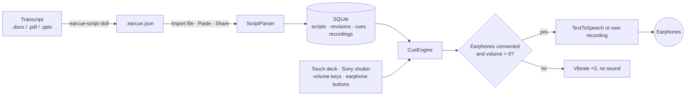

<div align="center">


# EarCue

Ein Android-Prompter, der deinen Vortrag in die Kopfhörer liest, ein Satz pro Daumendruck.

[APK herunterladen](https://github.com/naritaroad/EarCue/releases/latest) · [Skriptformat](../../skills/earcue-script/reference/format.md) · [Issues](https://github.com/naritaroad/EarCue/issues)


[English](../../README.md) | [繁體中文](README.zh-TW.md) | [简体中文](README.zh-CN.md) | [Español](README.es.md) | [Português (Brasil)](README.pt-BR.md) | [日本語](README.ja.md) | [한국어](README.ko.md) | [Français](README.fr.md) | **Deutsch** | [Русский](README.ru.md)

</div>

## Funktionen

- **Sofortiger Wechsel**: jeder Druck auf Weiter oder Zurück bricht den aktuellen Satz ab und startet den neuen, nichts überlagert sich und du wartest nie auf das Satzende.
- **Kopfhörerschutz**: ohne Kopfhörer oder bei Medienlautstärke 0 vibrieren die Wiedergabetasten dreimal und bleiben stumm. Kopfhörer abziehen stoppt die Wiedergabe.
- **Bedienung mit einem Daumen**: drei Tastenlayouts, Verschieben und Größe ändern per Ziehen mit Zurücksetzen, Spiegelung für Links- und Rechtshänder und ein schwarzer Bühnenmodus für das Telefon hinter dem Rücken.
- **Hardwaretasten**: Sony-Auslöser (drücken = weiter, halten = zurück), optional Lautstärketasten sowie Tasten kabelgebundener oder Bluetooth-Kopfhörer.
- **Stimmen**: Android-Sprachausgabe mit Tempo 0,25×–2,00× (− oder + halten für stufenloses Ändern), Tonhöhe, Engine und Stimmenwahl nach Region und Offline-Nutzung gefiltert, wortweises Hervorheben oder eigene Aufnahme pro Satz.
- **Skriptbibliothek**: lokale SQLite-Speicherung mit Suche in Titeln, Tags und Text, Tag-Filtern und einem Verlauf wie bei git: Skript aus neuer Datei aktualisieren und jede frühere Revision wiederherstellen.
- **KI-Konvertierungs-Skill**: `skills/earcue-script` wandelt ein Word-, PDF- oder Folien-Transkript in eine `.earcue.json` mit Tags um und prüft sie Wort für Wort gegen die Quelle.
- **10 UI-Sprachen**: mit hellem und dunklem Design: English, 繁體中文, 简体中文, Español, Português (Brasil), 日本語, 한국어, Français, Deutsch, Русский.

## Demo

<p align="center">
  
  
  
  
  
</p>

Probiere es mit dem fiktiven Vortrag in [`examples/green-streets/`](../../examples/green-streets/): Foliensatz, zweisprachiges Transkript und die konvertierte Datei für Person P2.

## Architektur



Jeder Import wird zu einer Revision des Skripts, die aktuelle Revision wird in Abschnitte aufgeteilt. `CueEngine` steuert die Wiedergabe: Sie verwirft den vorigen Satz vor dem nächsten und prüft bei jedem Druck die Audioausgabe. Details: [docs/architecture.md](../architecture.md)

## Technische Details

<details>
<summary>Technik</summary>

| Bereich | Wahl |
|---|---|
| Sprache | Kotlin 2.1, JDK 17 |
| UI | Jetpack Compose (BOM 2024.12.01), Material 3, selbst gezeichnete Icons |
| Speicher | Plattform-`SQLiteOpenHelper` (kein ORM), SharedPreferences für Einstellungen |
| Sprache/Audio | `TextToSpeech`, `MediaPlayer` für eigene Aufnahmen, `MediaSession` für Kopfhörertasten |
| Build | Android Gradle Plugin 8.7.3, Gradle 8.11.1, compileSdk 35, minSdk 26 |
| Release-APK | etwa 1,4 MB, mit R8 verkleinert |

</details>

<details>
<summary>Skriptformat</summary>

```json
{
  "format": "earcue/1",
  "title": "Green Streets at Night · P2 Background",
  "speaker": "P2 Mina Park",
  "lang": "en-US",
  "tags": ["demo", "paper-review"],
  "sections": [
    {
      "title": "Why are summer nights getting hotter?",
      "slide": "P2",
      "minutes": 2.5,
      "cues": [
        { "partner": "P1 Alex Rivera", "text": "Quick poll first. ..." },
        { "text": "I am one of them. ...", "note": "On-screen hint" }
      ]
    }
  ]
}
```

Ein einfaches Textformat zum Einfügen wird ebenfalls akzeptiert. Vollständige Spezifikation: [format.md](../../skills/earcue-script/reference/format.md)

</details>

<details>
<summary>Berechtigungen</summary>

| Berechtigung | Zweck |
|---|---|
| `VIBRATE` | Haptisches Feedback und Warnung des Kopfhörerschutzes |
| `RECORD_AUDIO` | Nur beim Aufnehmen der eigenen Stimme für einen Satz; wird dann abgefragt |

Die App deklariert keine Internetberechtigung. Online-TTS-Stimmen lädt die Sprachausgabe, nicht EarCue.

</details>

## Installation

Lade `EarCue-<version>.apk` unter [Releases](https://github.com/naritaroad/EarCue/releases/latest) herunter, öffne sie auf dem Telefon und erlaube die Installation aus dieser Quelle. Android 8.0 oder neuer ist nötig.

Aus dem Quellcode bauen (JDK 17 und Android SDK 35):

```bash
./gradlew assembleRelease
```

Vollständige Anleitung inklusive Einrichtung des KI-Skills: [docs/installation.md](../installation.md)

## Projektstruktur

```
EarCue/
├── app/src/main/
│   ├── java/app/earcue/   # audio/ data/ ui/
│   └── res/               # icons, strings × 10 languages (generated)
├── skills/earcue-script/  # AI conversion skill
├── examples/green-streets/# fictional demo
├── tools/
│   ├── i18n/              # UI string tables + generator
│   ├── readme/            # README template + translations
│   └── demo/              # demo file builder
├── design/                # logo source
└── docs/                  # installation, architecture, assets, README/ (translations)
```

## Mitwirken

Issues und Pull Requests sind willkommen. UI-Texte liegen in `tools/i18n/`; führe nach Änderungen `python tools/i18n/gen_strings.py` aus. [CONTRIBUTING.md](../../CONTRIBUTING.md)

## Lizenz

Kostenlos für private, schulische, wissenschaftliche und gemeinnützige Nutzung zu MIT-Bedingungen; kommerzielle Nutzung braucht die schriftliche Erlaubnis des Autors. [LICENSE](../../LICENSE)
