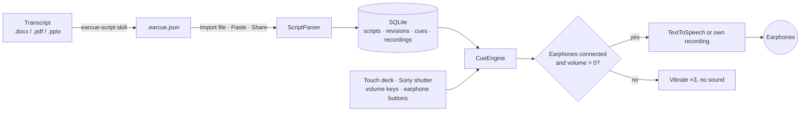

<div align="center">


# EarCue

Un apuntador para Android que lee tu discurso en tus auriculares, una frase por pulsación del pulgar.

[Descargar APK](https://github.com/naritaroad/EarCue/releases/latest) · [Formato del guion](../../skills/earcue-script/reference/format.md) · [Incidencias](https://github.com/naritaroad/EarCue/issues)


[English](../../README.md) | [繁體中文](README.zh-TW.md) | [简体中文](README.zh-CN.md) | **Español** | [Português (Brasil)](README.pt-BR.md) | [日本語](README.ja.md) | [한국어](README.ko.md) | [Français](README.fr.md) | [Deutsch](README.de.md) | [Русский](README.ru.md)

</div>

## Funciones

- **Cambio instantáneo**: cada pulsación de Siguiente o Anterior corta la frase actual y empieza la nueva, así nunca se solapan ni hay que esperar a que termine.
- **Protección de auriculares**: sin auriculares conectados o con el volumen multimedia en 0, los botones de reproducción vibran tres veces y no suenan. Desconectar los auriculares detiene la reproducción.
- **Control con un pulgar**: tres diseños de botones, edición arrastrando para mover y redimensionar con restablecimiento, espejo para zurdos y diestros, y un modo Escenario negro para el teléfono a la espalda.
- **Botones físicos**: obturador Sony (pulsar = siguiente, mantener = anterior), teclas de volumen opcionales y botones de auriculares con cable o Bluetooth.
- **Voces**: texto a voz de Android con velocidad 0,25×–2,00× (mantén − o + para cambiarla de forma continua), tono, motor y voz filtrados por región y uso sin conexión, resaltado palabra por palabra o tu propia grabación por frase.
- **Biblioteca de guiones**: almacenamiento local en SQLite con búsqueda por título, etiquetas y texto, filtros por etiqueta e historial al estilo git: actualiza un guion con un archivo nuevo y restaura cualquier revisión anterior.
- **Skill de conversión con IA**: `skills/earcue-script` convierte una transcripción de Word, PDF o diapositivas en un `.earcue.json` con etiquetas y lo compara palabra por palabra con el original.
- **10 idiomas de interfaz**: con temas claro y oscuro: English, 繁體中文, 简体中文, Español, Português (Brasil), 日本語, 한국어, Français, Deutsch, Русский.

## Demostración

<p align="center">
  
  
  
  
  
</p>

Pruébalo con la charla ficticia de [`examples/green-streets/`](../../examples/green-streets/): presentación, transcripción bilingüe y el archivo convertido para el presentador P2.

## Arquitectura



Cada importación se convierte en una revisión del guion, y la revisión actual se expande en fragmentos. `CueEngine` gestiona la reproducción: vacía la frase anterior antes de empezar la siguiente y comprueba la salida de audio en cada pulsación. Detalles: [docs/architecture.md](../architecture.md)

## Detalles técnicos

<details>
<summary>Tecnologías</summary>

| Parte | Elección |
|---|---|
| Lenguaje | Kotlin 2.1, JDK 17 |
| Interfaz | Jetpack Compose (BOM 2024.12.01), Material 3, iconos dibujados a mano |
| Almacenamiento | `SQLiteOpenHelper` de la plataforma (sin ORM), SharedPreferences para ajustes |
| Voz | `TextToSpeech`, `MediaPlayer` para grabaciones propias, `MediaSession` para botones de auriculares |
| Compilación | Android Gradle Plugin 8.7.3, Gradle 8.11.1, compileSdk 35, minSdk 26 |
| APK de release | unos 1,4 MB, reducido con R8 |

</details>

<details>
<summary>Formato del guion</summary>

```json
{
  "format": "earcue/1",
  "title": "Green Streets at Night · P2 Background",
  "speaker": "P2 Mina Park",
  "lang": "en-US",
  "tags": ["demo", "paper-review"],
  "sections": [
    {
      "title": "Why are summer nights getting hotter?",
      "slide": "P2",
      "minutes": 2.5,
      "cues": [
        { "partner": "P1 Alex Rivera", "text": "Quick poll first. ..." },
        { "text": "I am one of them. ...", "note": "On-screen hint" }
      ]
    }
  ]
}
```

También se acepta un formato de texto simple para pegar. Especificación completa: [format.md](../../skills/earcue-script/reference/format.md)

</details>

<details>
<summary>Permisos</summary>

| Permiso | Motivo |
|---|---|
| `VIBRATE` | Respuesta háptica y aviso de protección de auriculares |
| `RECORD_AUDIO` | Solo al grabar tu propia voz para una frase; se pide en ese momento |

La app no declara permiso de internet. Las voces TTS en línea las descarga el motor de voz, no EarCue.

</details>

## Instalación

Descarga `EarCue-<version>.apk` desde [Releases](https://github.com/naritaroad/EarCue/releases/latest), ábrelo en el teléfono y permite instalar desde ese origen. Requiere Android 8.0 o posterior.

Para compilar desde el código (JDK 17 y Android SDK 35):

```bash
./gradlew assembleRelease
```

Guía completa, incluida la configuración de la skill de IA: [docs/installation.md](../installation.md)

## Estructura del proyecto

```
EarCue/
├── app/src/main/
│   ├── java/app/earcue/   # audio/ data/ ui/
│   └── res/               # icons, strings × 10 languages (generated)
├── skills/earcue-script/  # AI conversion skill
├── examples/green-streets/# fictional demo
├── tools/
│   ├── i18n/              # UI string tables + generator
│   ├── readme/            # README template + translations
│   └── demo/              # demo file builder
├── design/                # logo source
└── docs/                  # installation, architecture, assets, README/ (translations)
```

## Contribuir

Las incidencias y pull requests son bienvenidas. Los textos de la interfaz están en `tools/i18n/`; ejecuta `python tools/i18n/gen_strings.py` tras editarlos. [CONTRIBUTING.md](../../CONTRIBUTING.md)

## Licencia

Gratis para uso personal, educativo, de investigación y sin ánimo de lucro bajo términos MIT; el uso comercial requiere permiso escrito del autor. [LICENSE](../../LICENSE)
