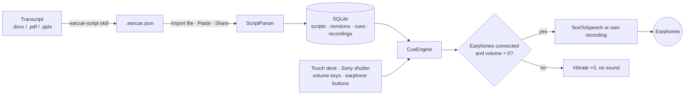

<div align="center">


# EarCue

Un prompteur Android qui lit votre discours dans vos écouteurs, une phrase par pression du pouce.

[Télécharger l'APK](https://github.com/naritaroad/EarCue/releases/latest) · [Format du script](../../skills/earcue-script/reference/format.md) · [Issues](https://github.com/naritaroad/EarCue/issues)


[English](../../README.md) | [繁體中文](README.zh-TW.md) | [简体中文](README.zh-CN.md) | [Español](README.es.md) | [Português (Brasil)](README.pt-BR.md) | [日本語](README.ja.md) | [한국어](README.ko.md) | **Français** | [Deutsch](README.de.md) | [Русский](README.ru.md)

</div>

## Fonctionnalités

- **Changement instantané**: chaque pression sur Suivant ou Précédent coupe la phrase en cours et lance la nouvelle : rien ne se chevauche et vous n'attendez jamais la fin d'une phrase.
- **Protection des écouteurs**: sans écouteurs ou avec le volume multimédia à 0, les boutons de lecture vibrent trois fois sans émettre de son. Débrancher les écouteurs arrête la lecture.
- **Contrôle au pouce**: trois dispositions de boutons, édition par glisser pour déplacer et redimensionner avec réinitialisation, miroir gaucher/droitier et un mode Scène noir pour le téléphone tenu dans le dos.
- **Boutons physiques**: déclencheur Sony (appui = suivant, maintien = précédent), touches de volume en option et boutons d'écouteurs filaires ou Bluetooth.
- **Voix**: synthèse vocale Android avec vitesse de 0,25× à 2,00× (maintenez − ou + pour régler en continu), hauteur, moteur et voix filtrés par région et hors ligne, surlignage mot à mot ou votre propre enregistrement par phrase.
- **Bibliothèque de scripts**: stockage SQLite local avec recherche sur titres, tags et texte, filtres par tag et historique à la git : mettez un script à jour avec un nouveau fichier et restaurez n'importe quelle révision.
- **Skill de conversion IA**: `skills/earcue-script` transforme une transcription Word, PDF ou diapositives en `.earcue.json` avec tags et la compare mot à mot à la source.
- **10 langues d'interface**: avec thèmes clair et sombre : English, 繁體中文, 简体中文, Español, Português (Brasil), 日本語, 한국어, Français, Deutsch, Русский.

## Démo

<p align="center">
  
  
  
  
  
</p>

Essayez avec l'exposé fictif de [`examples/green-streets/`](../../examples/green-streets/) : diaporama, transcription bilingue et fichier converti pour l'orateur P2.

## Architecture



Chaque import devient une révision du script, et la révision courante est développée en passages. `CueEngine` gère la lecture : il vide la phrase précédente avant de lancer la suivante et vérifie la sortie audio à chaque pression. Détails : [docs/architecture.md](../architecture.md)

## Détails techniques

<details>
<summary>Pile technique</summary>

| Élément | Choix |
|---|---|
| Langage | Kotlin 2.1, JDK 17 |
| Interface | Jetpack Compose (BOM 2024.12.01), Material 3, icônes dessinées à la main |
| Stockage | `SQLiteOpenHelper` de la plateforme (sans ORM), SharedPreferences pour les réglages |
| Voix | `TextToSpeech`, `MediaPlayer` pour vos enregistrements, `MediaSession` pour les boutons d'écouteurs |
| Compilation | Android Gradle Plugin 8.7.3, Gradle 8.11.1, compileSdk 35, minSdk 26 |
| APK de release | environ 1,4 Mo, réduit avec R8 |

</details>

<details>
<summary>Format du script</summary>

```json
{
  "format": "earcue/1",
  "title": "Green Streets at Night · P2 Background",
  "speaker": "P2 Mina Park",
  "lang": "en-US",
  "tags": ["demo", "paper-review"],
  "sections": [
    {
      "title": "Why are summer nights getting hotter?",
      "slide": "P2",
      "minutes": 2.5,
      "cues": [
        { "partner": "P1 Alex Rivera", "text": "Quick poll first. ..." },
        { "text": "I am one of them. ...", "note": "On-screen hint" }
      ]
    }
  ]
}
```

Un format texte simple à coller est aussi accepté. Spécification complète : [format.md](../../skills/earcue-script/reference/format.md)

</details>

<details>
<summary>Autorisations</summary>

| Autorisation | Raison |
|---|---|
| `VIBRATE` | Retour haptique et alerte de protection des écouteurs |
| `RECORD_AUDIO` | Seulement pour enregistrer votre voix sur une phrase ; demandée à ce moment-là |

L'application ne déclare aucune autorisation Internet. Les voix TTS en ligne sont téléchargées par le moteur vocal, pas par EarCue.

</details>

## Installation

Téléchargez `EarCue-<version>.apk` depuis [Releases](https://github.com/naritaroad/EarCue/releases/latest), ouvrez-le sur le téléphone et autorisez l'installation depuis cette source. Android 8.0 ou plus récent est requis.

Pour compiler depuis les sources (JDK 17 et Android SDK 35) :

```bash
./gradlew assembleRelease
```

Guide complet, avec la configuration de la skill IA : [docs/installation.md](../installation.md)

## Structure du projet

```
EarCue/
├── app/src/main/
│   ├── java/app/earcue/   # audio/ data/ ui/
│   └── res/               # icons, strings × 10 languages (generated)
├── skills/earcue-script/  # AI conversion skill
├── examples/green-streets/# fictional demo
├── tools/
│   ├── i18n/              # UI string tables + generator
│   ├── readme/            # README template + translations
│   └── demo/              # demo file builder
├── design/                # logo source
└── docs/                  # installation, architecture, assets, README/ (translations)
```

## Contribuer

Les issues et pull requests sont les bienvenues. Les textes de l'interface sont dans `tools/i18n/` ; lancez `python tools/i18n/gen_strings.py` après modification. [CONTRIBUTING.md](../../CONTRIBUTING.md)

## Licence

Gratuit pour un usage personnel, éducatif, de recherche et non lucratif selon les termes MIT ; l'usage commercial nécessite l'autorisation écrite de l'auteur. [LICENSE](../../LICENSE)
