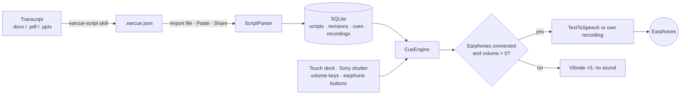

<div align="center">


# EarCue

原稿をイヤホンに読み上げる Android のプロンプター。親指で一回押すごとに次の一文へ。

[APK をダウンロード](https://github.com/naritaroad/EarCue/releases/latest) · [原稿フォーマット](../../skills/earcue-script/reference/format.md) · [Issues](https://github.com/naritaroad/EarCue/issues)


[English](../../README.md) | [繁體中文](README.zh-TW.md) | [简体中文](README.zh-CN.md) | [Español](README.es.md) | [Português (Brasil)](README.pt-BR.md) | **日本語** | [한국어](README.ko.md) | [Français](README.fr.md) | [Deutsch](README.de.md) | [Русский](README.ru.md)

</div>

## 機能

- **即時切り替え**: 「次へ」「前へ」を押すたびに今の文を止めて新しい文を再生するので、音が重なりません。長押しで 1 文ずつ移動、「再生」の長押しで最初から。スライド切り替えと話者交代の合図音も使えます。
- **イヤホン保護**: イヤホン未接続やメディア音量 0 のときは、再生系ボタンが 3 回振動するだけで音は出ません。再生中にイヤホンが外れると停止します。
- **親指ひとつで操作**: 3 種類のボタン配置、ドラッグで移動・サイズ変更と初期化、左右反転、スマホを背中に隠すための黒いステージモード。
- **物理ボタン**: Sony のシャッターボタン（押す＝次へ、長押し＝先へ連続で進む）、任意で音量キー、有線・Bluetooth イヤホンのボタン。
- **音声**: Android の音声合成で速度 0.25×–2.00×、男性・女性の切り替え、6 種類のプリセット音声、パートナーのセリフ用の音声とピッチ、単語ごとのハイライト、各文に自分の録音も使えます。
- **原稿ライブラリ**: 端末内の SQLite に保存し、タイトル・タグ・本文を検索、タグで分類。git のような履歴で、新しいファイルで更新し、過去の版にいつでも戻せます。
- **AI 変換 skill**: `skills/earcue-script` が Word・PDF・スライドの原稿をタグ付きの `.earcue.json` に変換し、元の原稿と一字一句照合します。
- **10 言語の UI**: ライト／ダークテーマ対応：English、繁體中文、简体中文、Español、Português (Brasil)、日本語、한국어、Français、Deutsch、Русский。

## デモ

<p align="center">
  
  
  
  
  
</p>

[`examples/green-streets/`](../../examples/green-streets/) の架空の発表で試せます。スライド、英中対訳の原稿、発表者 P2 用の変換済みファイルが入っています。

## アーキテクチャ



取り込むたびに原稿の版が増え、現在の版がキューに展開されます。`CueEngine` が再生を担当し、次の文を始める前に前の文を破棄し、押すたびに音声出力を確認します。詳細： [docs/architecture.md](../architecture.md)

## 技術的な詳細

<details>
<summary>技術スタック</summary>

| 項目 | 採用技術 |
|---|---|
| 言語 | Kotlin 2.1、JDK 17 |
| UI | Jetpack Compose（BOM 2024.12.01）、Material 3、自作アイコン |
| 保存 | プラットフォームの `SQLiteOpenHelper`（ORM なし）、設定は SharedPreferences |
| 音声 | `TextToSpeech`、自分の録音は `MediaPlayer`、イヤホンのボタンは `MediaSession` |
| ビルド | Android Gradle Plugin 8.7.3、Gradle 8.11.1、compileSdk 35、minSdk 26 |
| リリース APK | 約 1.4 MB、R8 で縮小 |

</details>

<details>
<summary>原稿フォーマット</summary>

```json
{
  "format": "earcue/1",
  "title": "Green Streets at Night · P2 Background",
  "speaker": "P2 Mina Park",
  "lang": "en-US",
  "tags": ["demo", "paper-review"],
  "sections": [
    {
      "title": "Why are summer nights getting hotter?",
      "slide": "P2",
      "minutes": 2.5,
      "cues": [
        { "partner": "P1 Alex Rivera", "text": "Quick poll first. ..." },
        { "text": "I am one of them. ...", "note": "On-screen hint" }
      ]
    }
  ]
}
```

貼り付け用のテキスト形式にも対応しています。仕様の全文： [format.md](../../skills/earcue-script/reference/format.md)

</details>

<details>
<summary>権限</summary>

| 権限 | 用途 |
|---|---|
| `VIBRATE` | 触覚フィードバックとイヤホン保護の警告 |
| `RECORD_AUDIO` | 文に自分の声を録音するときだけ。その時点で確認します |

アプリはインターネット権限を宣言していません。オンラインの TTS 音声は EarCue ではなく音声エンジンが取得します。

</details>

## インストール

[Releases](https://github.com/naritaroad/EarCue/releases/latest) から `EarCue-<version>.apk` をダウンロードし、スマホで開いてそのアプリからのインストールを許可します。Android 8.0 以降が必要です。

ソースからビルドする場合（JDK 17 と Android SDK 35）：

```bash
./gradlew assembleRelease
```

AI skill の設定を含む完全ガイド： [docs/installation.md](../installation.md)

## プロジェクト構成

```
EarCue/
├── app/src/main/
│   ├── java/app/earcue/   # audio/ data/ ui/
│   └── res/               # icons, strings × 10 languages (generated)
├── skills/earcue-script/  # AI conversion skill
├── examples/green-streets/# fictional demo
├── tools/
│   ├── i18n/              # UI string tables + generator
│   ├── readme/            # README template + translations
│   ├── audio/             # reminder tone generator
│   └── demo/              # demo file builder
├── design/                # logo source
└── docs/                  # installation, architecture, assets, README/ (translations)
```

## コントリビュート

Issue と pull request を歓迎します。UI の文言は `tools/i18n/` にあり、編集後に `python tools/i18n/gen_strings.py` を実行してください。 [CONTRIBUTING.md](../../CONTRIBUTING.md)

## ライセンス

個人・教育・研究・非営利の利用は MIT の条件で無料です。商用利用には作者の書面による許可が必要です。 [LICENSE](../../LICENSE)
