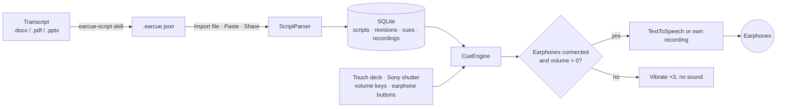

<div align="center">


# EarCue

원고를 이어폰으로 읽어 주는 Android 프롬프터. 엄지로 한 번 누를 때마다 다음 문장.

[APK 다운로드](https://github.com/naritaroad/EarCue/releases/latest) · [원고 형식](../../skills/earcue-script/reference/format.md) · [이슈](https://github.com/naritaroad/EarCue/issues)


[English](../../README.md) | [繁體中文](README.zh-TW.md) | [简体中文](README.zh-CN.md) | [Español](README.es.md) | [Português (Brasil)](README.pt-BR.md) | [日本語](README.ja.md) | **한국어** | [Français](README.fr.md) | [Deutsch](README.de.md) | [Русский](README.ru.md)

</div>

## 기능

- **즉시 전환**: "다음"이나 "이전"을 누를 때마다 지금 문장을 끊고 새 문장을 재생해, 소리가 겹치거나 문장이 끝나길 기다리지 않습니다.
- **이어폰 보호**: 이어폰이 없거나 미디어 볼륨이 0이면 재생 버튼은 세 번 진동만 하고 소리를 내지 않습니다. 재생 중 이어폰을 빼면 멈춥니다.
- **엄지 하나로 조작**: 세 가지 버튼 배치, 끌어서 옮기고 크기를 바꾸는 편집과 초기화, 왼손/오른손 반전, 휴대폰을 등 뒤에 둘 때 쓰는 검은 무대 모드.
- **물리 버튼**: Sony 셔터 버튼(누르기 = 다음, 길게 누르기 = 이전), 선택 가능한 볼륨 키, 유선·블루투스 이어폰 버튼.
- **음성**: Android 음성 합성으로 속도 0.25×–2.00×(− 또는 +를 길게 눌러 연속 조절), 음높이, 엔진, 지역과 오프라인으로 거르는 음성 선택, 단어별 강조 표시, 문장마다 내 녹음도 가능.
- **원고 보관함**: 기기 내 SQLite에 저장하고 제목·태그·본문 검색, 태그 필터, git 같은 기록 제공: 새 파일로 원고를 업데이트하고 이전 버전으로 언제든 되돌릴 수 있습니다.
- **AI 변환 skill**: `skills/earcue-script`가 Word, PDF, 슬라이드 원고를 태그가 달린 `.earcue.json`으로 바꾸고 원문과 한 단어씩 대조합니다.
- **10개 UI 언어**: 밝은 테마와 어두운 테마 지원: English, 繁體中文, 简体中文, Español, Português (Brasil), 日本語, 한국어, Français, Deutsch, Русский.

## 데모

<p align="center">
  
  
  
  
  
</p>

[`examples/green-streets/`](../../examples/green-streets/)의 가상 발표로 시험해 보세요. 슬라이드, 영중 대역 원고, 발표자 P2용 변환 파일이 들어 있습니다.

## 아키텍처



가져올 때마다 원고의 새 버전이 생기고, 현재 버전이 구간으로 펼쳐집니다. `CueEngine`이 재생을 맡아 다음 문장 전에 이전 문장을 비우고, 누를 때마다 오디오 출력을 확인합니다. 자세히: [docs/architecture.md](../architecture.md)

## 기술 정보

<details>
<summary>기술 스택</summary>

| 항목 | 선택 |
|---|---|
| 언어 | Kotlin 2.1, JDK 17 |
| UI | Jetpack Compose(BOM 2024.12.01), Material 3, 직접 그린 아이콘 |
| 저장 | 플랫폼 `SQLiteOpenHelper`(ORM 없음), 설정은 SharedPreferences |
| 음성 | `TextToSpeech`, 내 녹음은 `MediaPlayer`, 이어폰 버튼은 `MediaSession` |
| 빌드 | Android Gradle Plugin 8.7.3, Gradle 8.11.1, compileSdk 35, minSdk 26 |
| 릴리스 APK | 약 1.4MB, R8로 축소 |

</details>

<details>
<summary>원고 형식</summary>

```json
{
  "format": "earcue/1",
  "title": "Green Streets at Night · P2 Background",
  "speaker": "P2 Mina Park",
  "lang": "en-US",
  "tags": ["demo", "paper-review"],
  "sections": [
    {
      "title": "Why are summer nights getting hotter?",
      "slide": "P2",
      "minutes": 2.5,
      "cues": [
        { "partner": "P1 Alex Rivera", "text": "Quick poll first. ..." },
        { "text": "I am one of them. ...", "note": "On-screen hint" }
      ]
    }
  ]
}
```

붙여넣기용 텍스트 형식도 지원합니다. 전체 사양: [format.md](../../skills/earcue-script/reference/format.md)

</details>

<details>
<summary>권한</summary>

| 권한 | 용도 |
|---|---|
| `VIBRATE` | 햅틱 피드백과 이어폰 보호 경고 |
| `RECORD_AUDIO` | 문장에 내 목소리를 녹음할 때만, 그때 요청합니다 |

앱은 인터넷 권한을 선언하지 않습니다. 온라인 TTS 음성은 EarCue가 아니라 음성 엔진이 받아옵니다.

</details>

## 설치

[Releases](https://github.com/naritaroad/EarCue/releases/latest)에서 `EarCue-<version>.apk`를 내려받아 휴대폰에서 열고 해당 출처의 설치를 허용하세요. Android 8.0 이상이 필요합니다.

소스에서 빌드하려면(JDK 17과 Android SDK 35):

```bash
./gradlew assembleRelease
```

AI skill 설정을 포함한 전체 안내: [docs/installation.md](../installation.md)

## 프로젝트 구조

```
EarCue/
├── app/src/main/
│   ├── java/app/earcue/   # audio/ data/ ui/
│   └── res/               # icons, strings × 10 languages (generated)
├── skills/earcue-script/  # AI conversion skill
├── examples/green-streets/# fictional demo
├── tools/
│   ├── i18n/              # UI string tables + generator
│   ├── readme/            # README template + translations
│   └── demo/              # demo file builder
├── design/                # logo source
└── docs/                  # installation, architecture, assets, README/ (translations)
```

## 기여하기

이슈와 pull request를 환영합니다. UI 문구는 `tools/i18n/`에 있으며 수정 후 `python tools/i18n/gen_strings.py`를 실행하세요. [CONTRIBUTING.md](../../CONTRIBUTING.md)

## 라이선스

개인·교육·연구·비영리 용도는 MIT 조건으로 무료이며, 상업적 이용은 작성자의 서면 허가가 필요합니다. [LICENSE](../../LICENSE)
