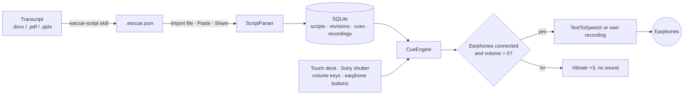

<div align="center">


# EarCue

Um ponto eletrônico para Android que lê sua fala nos fones, uma frase por toque do polegar.

[Baixar APK](https://github.com/naritaroad/EarCue/releases/latest) · [Formato do roteiro](../../skills/earcue-script/reference/format.md) · [Issues](https://github.com/naritaroad/EarCue/issues)


[English](../../README.md) | [繁體中文](README.zh-TW.md) | [简体中文](README.zh-CN.md) | [Español](README.es.md) | **Português (Brasil)** | [日本語](README.ja.md) | [한국어](README.ko.md) | [Français](README.fr.md) | [Deutsch](README.de.md) | [Русский](README.ru.md)

</div>

## Recursos

- **Troca instantânea**: cada toque em Próximo ou Anterior corta a frase atual e começa a nova, então as frases nunca se sobrepõem e você não espera uma terminar.
- **Proteção dos fones**: sem fones conectados ou com o volume de mídia em 0, os botões de reprodução vibram três vezes e não tocam nada. Tirar os fones no meio interrompe a reprodução.
- **Controle com um polegar**: três layouts de botões, edição arrastando para mover e redimensionar com restauração, espelho para canhotos e destros, e um modo Palco preto para o celular nas costas.
- **Botões físicos**: obturador Sony (pressionar = próximo, segurar = anterior), teclas de volume opcionais e botões de fones com fio ou Bluetooth.
- **Vozes**: texto para fala do Android com velocidade 0,25×–2,00× (segure − ou + para ajustar continuamente), tom, mecanismo e voz filtrados por região e uso offline, destaque palavra por palavra ou sua própria gravação por frase.
- **Biblioteca de roteiros**: armazenamento local em SQLite com busca por título, tags e texto, filtros por tag e histórico no estilo git: atualize um roteiro com um arquivo novo e restaure qualquer revisão anterior.
- **Skill de conversão com IA**: `skills/earcue-script` transforma uma transcrição em Word, PDF ou slides em um `.earcue.json` com tags e confere palavra por palavra com o original.
- **10 idiomas de interface**: com temas claro e escuro: English, 繁體中文, 简体中文, Español, Português (Brasil), 日本語, 한국어, Français, Deutsch, Русский.

## Demonstração

<p align="center">
  
  
  
  
  
</p>

Experimente com a palestra fictícia em [`examples/green-streets/`](../../examples/green-streets/): slides, transcrição bilíngue e o arquivo convertido para o apresentador P2.

## Arquitetura



Cada importação vira uma revisão do roteiro, e a revisão atual é expandida em trechos. O `CueEngine` cuida da reprodução: descarta a frase anterior antes de começar a próxima e verifica a saída de áudio a cada toque. Detalhes: [docs/architecture.md](../architecture.md)

## Detalhes técnicos

<details>
<summary>Tecnologias</summary>

| Parte | Escolha |
|---|---|
| Linguagem | Kotlin 2.1, JDK 17 |
| Interface | Jetpack Compose (BOM 2024.12.01), Material 3, ícones desenhados à mão |
| Armazenamento | `SQLiteOpenHelper` da plataforma (sem ORM), SharedPreferences para ajustes |
| Voz | `TextToSpeech`, `MediaPlayer` para gravações próprias, `MediaSession` para botões dos fones |
| Build | Android Gradle Plugin 8.7.3, Gradle 8.11.1, compileSdk 35, minSdk 26 |
| APK de release | cerca de 1,4 MB, reduzido com R8 |

</details>

<details>
<summary>Formato do roteiro</summary>

```json
{
  "format": "earcue/1",
  "title": "Green Streets at Night · P2 Background",
  "speaker": "P2 Mina Park",
  "lang": "en-US",
  "tags": ["demo", "paper-review"],
  "sections": [
    {
      "title": "Why are summer nights getting hotter?",
      "slide": "P2",
      "minutes": 2.5,
      "cues": [
        { "partner": "P1 Alex Rivera", "text": "Quick poll first. ..." },
        { "text": "I am one of them. ...", "note": "On-screen hint" }
      ]
    }
  ]
}
```

Um formato de texto simples para colar também é aceito. Especificação completa: [format.md](../../skills/earcue-script/reference/format.md)

</details>

<details>
<summary>Permissões</summary>

| Permissão | Motivo |
|---|---|
| `VIBRATE` | Resposta tátil e aviso de proteção dos fones |
| `RECORD_AUDIO` | Só ao gravar sua própria voz para uma frase; pedida nesse momento |

O app não declara permissão de internet. Vozes TTS online são baixadas pelo mecanismo de voz, não pelo EarCue.

</details>

## Instalação

Baixe `EarCue-<version>.apk` em [Releases](https://github.com/naritaroad/EarCue/releases/latest), abra no celular e permita a instalação dessa origem. Requer Android 8.0 ou superior.

Para compilar do código-fonte (JDK 17 e Android SDK 35):

```bash
./gradlew assembleRelease
```

Guia completo, incluindo a configuração da skill de IA: [docs/installation.md](../installation.md)

## Estrutura do projeto

```
EarCue/
├── app/src/main/
│   ├── java/app/earcue/   # audio/ data/ ui/
│   └── res/               # icons, strings × 10 languages (generated)
├── skills/earcue-script/  # AI conversion skill
├── examples/green-streets/# fictional demo
├── tools/
│   ├── i18n/              # UI string tables + generator
│   ├── readme/            # README template + translations
│   └── demo/              # demo file builder
├── design/                # logo source
└── docs/                  # installation, architecture, assets, README/ (translations)
```

## Contribuir

Issues e pull requests são bem-vindos. Os textos da interface ficam em `tools/i18n/`; rode `python tools/i18n/gen_strings.py` depois de editar. [CONTRIBUTING.md](../../CONTRIBUTING.md)

## Licença

Gratuito para uso pessoal, educacional, de pesquisa e sem fins lucrativos sob os termos MIT; uso comercial exige permissão por escrito do autor. [LICENSE](../../LICENSE)
