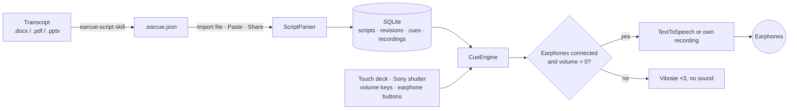

<div align="center">


# EarCue

Суфлёр для Android, который читает вашу речь в наушники: одна фраза на одно нажатие большим пальцем.

[Скачать APK](https://github.com/naritaroad/EarCue/releases/latest) · [Формат сценария](../../skills/earcue-script/reference/format.md) · [Issues](https://github.com/naritaroad/EarCue/issues)


[English](../../README.md) | [繁體中文](README.zh-TW.md) | [简体中文](README.zh-CN.md) | [Español](README.es.md) | [Português (Brasil)](README.pt-BR.md) | [日本語](README.ja.md) | [한국어](README.ko.md) | [Français](README.fr.md) | [Deutsch](README.de.md) | **Русский**

</div>

## Возможности

- **Мгновенное переключение**: каждое нажатие «Далее» или «Назад» обрывает текущую фразу и запускает новую, звук не накладывается. Удержание листает фразы по одной, удержание «Играть» начинает сначала, а сигналы отмечают смену слайда и докладчика.
- **Защита наушников**: без наушников или при нулевой громкости медиа кнопки воспроизведения трижды вибрируют и не издают звука. Отключение наушников останавливает воспроизведение.
- **Управление одним пальцем**: три раскладки кнопок, перемещение и изменение размера перетаскиванием со сбросом, зеркалирование для левшей и правшей и чёрный режим сцены для телефона за спиной.
- **Физические кнопки**: кнопка затвора Sony (нажатие = далее, удержание = листать вперёд), клавиши громкости по желанию и кнопки проводных или Bluetooth-наушников.
- **Голоса**: синтез речи Android со скоростью 0,25×–2,00×, переключатель женский/мужской голос, шесть готовых голосов, отдельный голос и высота для реплик партнёра, подсветка по словам или ваша запись для каждой фразы.
- **Библиотека сценариев**: локальное хранение в SQLite, поиск по названиям, тегам и тексту, фильтры по тегам и история как в git: обновляйте сценарий новым файлом и восстанавливайте любую прежнюю версию.
- **ИИ-навык конвертации**: `skills/earcue-script` превращает расшифровку из Word, PDF или слайдов в `.earcue.json` с тегами и сверяет её с исходником слово в слово.
- **10 языков интерфейса**: со светлой и тёмной темами: English, 繁體中文, 简体中文, Español, Português (Brasil), 日本語, 한국어, Français, Deutsch, Русский.

## Демо

<p align="center">
  
  
  
  
  
</p>

Попробуйте на вымышленном докладе из [`examples/green-streets/`](../../examples/green-streets/): слайды, двуязычная расшифровка и готовый файл для докладчика P2.

## Архитектура



Каждый импорт становится версией сценария, а текущая версия раскладывается на фрагменты. `CueEngine` отвечает за воспроизведение: сбрасывает предыдущую фразу перед следующей и проверяет аудиовыход при каждом нажатии. Подробнее: [docs/architecture.md](../architecture.md)

## Технические детали

<details>
<summary>Технологии</summary>

| Часть | Выбор |
|---|---|
| Язык | Kotlin 2.1, JDK 17 |
| Интерфейс | Jetpack Compose (BOM 2024.12.01), Material 3, собственные иконки |
| Хранение | Системный `SQLiteOpenHelper` (без ORM), SharedPreferences для настроек |
| Речь | `TextToSpeech`, `MediaPlayer` для своих записей, `MediaSession` для кнопок наушников |
| Сборка | Android Gradle Plugin 8.7.3, Gradle 8.11.1, compileSdk 35, minSdk 26 |
| Release APK | около 1,4 МБ, уменьшен R8 |

</details>

<details>
<summary>Формат сценария</summary>

```json
{
  "format": "earcue/1",
  "title": "Green Streets at Night · P2 Background",
  "speaker": "P2 Mina Park",
  "lang": "en-US",
  "tags": ["demo", "paper-review"],
  "sections": [
    {
      "title": "Why are summer nights getting hotter?",
      "slide": "P2",
      "minutes": 2.5,
      "cues": [
        { "partner": "P1 Alex Rivera", "text": "Quick poll first. ..." },
        { "text": "I am one of them. ...", "note": "On-screen hint" }
      ]
    }
  ]
}
```

Также поддерживается простой текстовый формат для вставки. Полная спецификация: [format.md](../../skills/earcue-script/reference/format.md)

</details>

<details>
<summary>Разрешения</summary>

| Разрешение | Зачем |
|---|---|
| `VIBRATE` | Тактильный отклик и предупреждение защиты наушников |
| `RECORD_AUDIO` | Только при записи своего голоса для фразы; запрашивается в этот момент |

Приложение не запрашивает доступ к интернету. Онлайн-голоса TTS загружает синтезатор речи, а не EarCue.

</details>

## Установка

Скачайте `EarCue-<version>.apk` в разделе [Releases](https://github.com/naritaroad/EarCue/releases/latest), откройте файл на телефоне и разрешите установку из этого источника. Нужен Android 8.0 или новее.

Сборка из исходников (JDK 17 и Android SDK 35):

```bash
./gradlew assembleRelease
```

Полное руководство, включая настройку ИИ-навыка: [docs/installation.md](../installation.md)

## Структура проекта

```
EarCue/
├── app/src/main/
│   ├── java/app/earcue/   # audio/ data/ ui/
│   └── res/               # icons, strings × 10 languages (generated)
├── skills/earcue-script/  # AI conversion skill
├── examples/green-streets/# fictional demo
├── tools/
│   ├── i18n/              # UI string tables + generator
│   ├── readme/            # README template + translations
│   ├── audio/             # reminder tone generator
│   └── demo/              # demo file builder
├── design/                # logo source
└── docs/                  # installation, architecture, assets, README/ (translations)
```

## Участие

Issues и pull requests приветствуются. Тексты интерфейса лежат в `tools/i18n/`; после правок запустите `python tools/i18n/gen_strings.py`. [CONTRIBUTING.md](../../CONTRIBUTING.md)

## Лицензия

Бесплатно для личного, учебного, исследовательского и некоммерческого использования на условиях MIT; коммерческое использование — только с письменного разрешения автора. [LICENSE](../../LICENSE)
