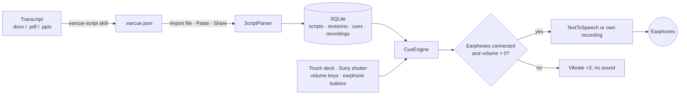

<div align="center">


# EarCue

Android 耳机提词应用：把讲稿念进你的耳机，拇指按一下就换下一句。

[下载 APK](https://github.com/naritaroad/EarCue/releases/latest) · [讲稿格式](../../skills/earcue-script/reference/format.md) · [问题反馈](https://github.com/naritaroad/EarCue/issues)


[English](../../README.md) | [繁體中文](README.zh-TW.md) | **简体中文** | [Español](README.es.md) | [Português (Brasil)](README.pt-BR.md) | [日本語](README.ja.md) | [한국어](README.ko.md) | [Français](README.fr.md) | [Deutsch](README.de.md) | [Русский](README.ru.md)

</div>

## 功能

- **即按即切**: 每次按“下一段”或“上一段”都会立刻切断当前句子并播放新的一句，不会重叠，也不必等一句念完。
- **耳机保护**: 未接耳机或媒体音量为 0 时，按播放类按键只会强振三下，不发出任何声音；播放中拔掉耳机会立刻停止。
- **单手拇指操作**: 三种预设按键布局，可拖动移动、拖动调整大小并一键恢复；左右手镜像；手机藏在背后时使用的全黑舞台模式。
- **实体按键**: Sony 快门键（短按＝下一段、按住＝上一段）、可选的音量键，以及有线或蓝牙耳机按键。
- **声音**: Android 文字转语音，语速 0.25×–2.00×（长按 − 或 ＋ 连续调节）、音调、引擎，声音模型可按地区与本地筛选；逐字高亮，也能为每一句录下自己的声音。
- **讲稿库**: 保存在本地 SQLite，可搜索标题、标签与正文，用标签分类，并有类似 git 的历史：用新文件更新讲稿，也能回退到任何旧版本。
- **AI 转换 skill**: `skills/earcue-script` 把 Word、PDF 或幻灯片讲稿转换成带标签的 `.earcue.json`，并与原稿逐字比对。
- **10 种界面语言**: 搭配浅色与深色主题：English、繁體中文、简体中文、Español、Português (Brasil)、日本語、한국어、Français、Deutsch、Русский。

## 演示

<p align="center">
  
  
  
  
  
</p>

用 [`examples/green-streets/`](../../examples/green-streets/) 中的虚构示例报告试试：包含幻灯片、中英对照讲稿，以及讲者 P2 的转换结果。

## 架构



每次导入都会成为讲稿的一个版本，当前版本再展开成一段段 cue。`CueEngine` 负责播放：开始新的一句前先清掉上一句，并在每次按键时检查音频输出。详见： [docs/architecture.md](../architecture.md)

## 技术细节

<details>
<summary>技术栈</summary>

| 项目 | 选择 |
|---|---|
| 语言 | Kotlin 2.1、JDK 17 |
| 界面 | Jetpack Compose（BOM 2024.12.01）、Material 3、自绘图标 |
| 存储 | 平台自带 `SQLiteOpenHelper`（不用 ORM），设置保存在 SharedPreferences |
| 语音 | `TextToSpeech`；自己的录音用 `MediaPlayer`；耳机按键用 `MediaSession` |
| 构建 | Android Gradle Plugin 8.7.3、Gradle 8.11.1、compileSdk 35、minSdk 26 |
| Release APK | 约 1.4 MB，经 R8 压缩 |

</details>

<details>
<summary>讲稿格式</summary>

```json
{
  "format": "earcue/1",
  "title": "Green Streets at Night · P2 Background",
  "speaker": "P2 Mina Park",
  "lang": "en-US",
  "tags": ["demo", "paper-review"],
  "sections": [
    {
      "title": "Why are summer nights getting hotter?",
      "slide": "P2",
      "minutes": 2.5,
      "cues": [
        { "partner": "P1 Alex Rivera", "text": "Quick poll first. ..." },
        { "text": "I am one of them. ...", "note": "On-screen hint" }
      ]
    }
  ]
}
```

也接受便于粘贴的纯文本格式。完整规范： [format.md](../../skills/earcue-script/reference/format.md)

</details>

<details>
<summary>权限</summary>

| 权限 | 用途 |
|---|---|
| `VIBRATE` | 振动反馈与耳机保护警示 |
| `RECORD_AUDIO` | 仅在你为某一句录制自己的声音时使用，届时才询问 |

应用没有声明网络权限。需要联网的 TTS 声音由语音引擎下载，不经过 EarCue。

</details>

## 安装

从 [Releases](https://github.com/naritaroad/EarCue/releases/latest) 下载 `EarCue-<version>.apk`，在手机上打开并允许从该来源安装。需要 Android 8.0 及以上。

从源码构建（需要 JDK 17 与 Android SDK 35）：

```bash
./gradlew assembleRelease
```

完整说明（含 AI skill 设置）： [docs/installation.md](../installation.md)

## 项目结构

```
EarCue/
├── app/src/main/
│   ├── java/app/earcue/   # audio/ data/ ui/
│   └── res/               # icons, strings × 10 languages (generated)
├── skills/earcue-script/  # AI conversion skill
├── examples/green-streets/# fictional demo
├── tools/
│   ├── i18n/              # UI string tables + generator
│   ├── readme/            # README template + translations
│   └── demo/              # demo file builder
├── design/                # logo source
└── docs/                  # installation, architecture, assets, README/ (translations)
```

## 参与贡献

欢迎提交 issue 与 pull request。界面文字位于 `tools/i18n/`，修改后运行 `python tools/i18n/gen_strings.py`。 [CONTRIBUTING.md](../../CONTRIBUTING.md)

## 许可

个人、教育、研究与非营利用途依 MIT 条款免费使用；商业使用需获得作者书面授权。 [LICENSE](../../LICENSE)
