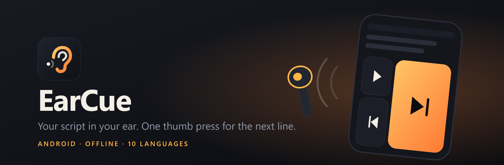
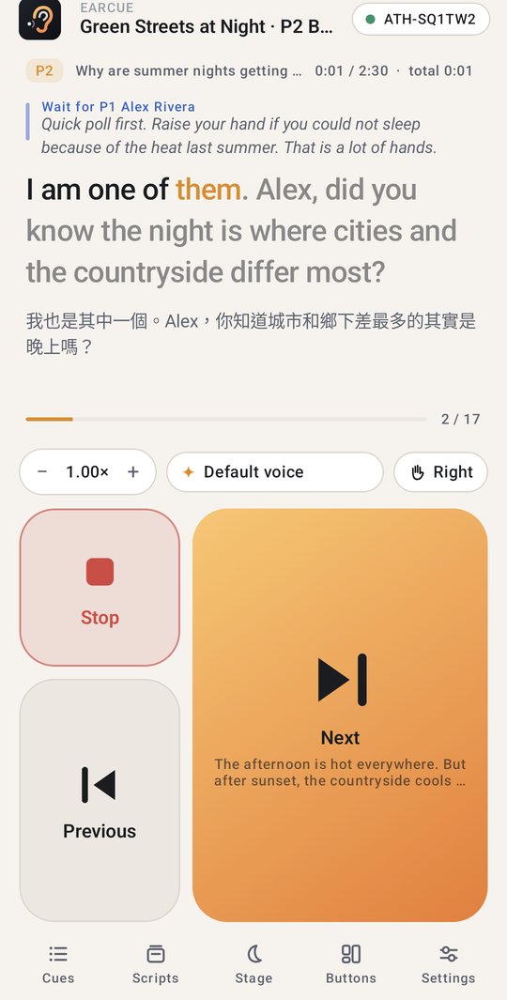
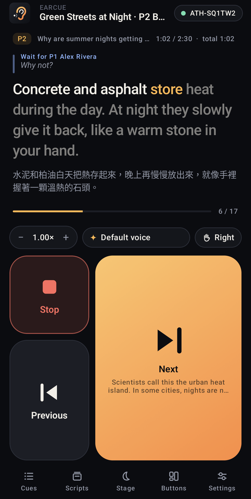
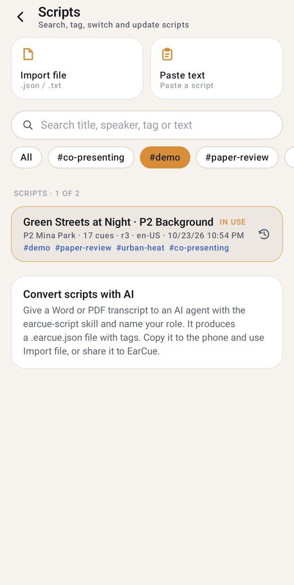
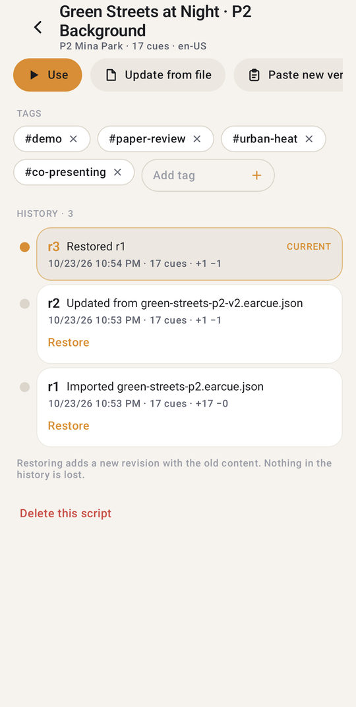
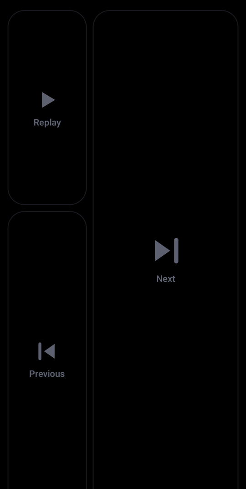
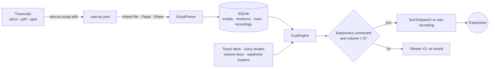

<div align="center">



# EarCue

Android 耳機提詞 App：把講稿唸進你的耳機，拇指按一下就換下一句。

[下載 APK](https://github.com/naritaroad/EarCue/releases/latest) · [講稿格式](../../skills/earcue-script/reference/format.md) · [問題回報](https://github.com/naritaroad/EarCue/issues)


[English](../../README.md) | **繁體中文** | [简体中文](README.zh-CN.md) | [Español](README.es.md) | [Português (Brasil)](README.pt-BR.md) | [日本語](README.ja.md) | [한국어](README.ko.md) | [Français](README.fr.md) | [Deutsch](README.de.md) | [Русский](README.ru.md)

</div>

## 功能

- **即按即切**: 每次按「下一段」或「上一段」都會立刻切斷目前的句子並播放新的一句，不會重疊。按住可一段一段連續跳，按住「播放」回到第一段；也可以開啟換頁與換人提示音。
- **耳機保護**: 沒接耳機，或媒體音量為 0 時，按播放類按鍵只會強震三下，不發出任何聲音；播放中拔掉耳機會立刻停止。
- **單手拇指操作**: 三種預設按鍵配置，可拖曳移動、拖曳調整大小並一鍵還原；左右手鏡像；手機藏在背後時用的全黑舞台模式。
- **實體按鍵**: Sony 快門鍵（短按＝下一段、按住＝連續往後跳）、可選的音量鍵，以及有線或藍牙耳機按鍵。
- **聲音**: Android 文字轉語音，語速 0.25×–2.00×，可一鍵切換男聲女聲、六種預設聲音，搭檔台詞可另設聲音與音調；逐字高亮，也能為每一句錄下自己的聲音。
- **講稿庫**: 存在本機 SQLite，可搜尋標題、標籤與內文，用標籤分類，並有類似 git 的歷史：用新檔案更新講稿，也能回退到任何舊版本。
- **AI 轉檔 skill**: `skills/earcue-script` 把 Word、PDF 或投影片講稿轉成含標籤的 `.earcue.json`，並與原稿逐字比對。
- **10 種介面語言**: 搭配淺色與深色主題：English、繁體中文、简体中文、Español、Português (Brasil)、日本語、한국어、Français、Deutsch、Русский。

## 展示

<p align="center">
  
  
  
  
  
</p>

用 [`examples/green-streets/`](../../examples/green-streets/) 的虛構範例報告試試看：裡面有投影片、中英對照逐字稿，以及講者 P2 的轉換結果。

## 架構



每次匯入都會成為講稿的一個版本，目前版本再展開成一段段 cue。`CueEngine` 負責播放：開始新的一句前先清掉上一句，並在每次按鍵時檢查音訊輸出。詳見： [docs/zh-TW/architecture.md](../zh-TW/architecture.md)

## 技術細節

<details>
<summary>技術棧</summary>

| 項目 | 選擇 |
|---|---|
| 語言 | Kotlin 2.1、JDK 17 |
| 介面 | Jetpack Compose（BOM 2024.12.01）、Material 3、自繪圖示 |
| 儲存 | 平台內建 `SQLiteOpenHelper`（不用 ORM），設定存在 SharedPreferences |
| 語音 | `TextToSpeech`；自己的錄音用 `MediaPlayer`；耳機按鍵用 `MediaSession` |
| 建置 | Android Gradle Plugin 8.7.3、Gradle 8.11.1、compileSdk 35、minSdk 26 |
| Release APK | 約 1.4 MB，以 R8 縮減 |

</details>

<details>
<summary>講稿格式</summary>

```json
{
  "format": "earcue/1",
  "title": "Green Streets at Night · P2 Background",
  "speaker": "P2 Mina Park",
  "lang": "en-US",
  "tags": ["demo", "paper-review"],
  "sections": [
    {
      "title": "Why are summer nights getting hotter?",
      "slide": "P2",
      "minutes": 2.5,
      "cues": [
        { "partner": "P1 Alex Rivera", "text": "Quick poll first. ..." },
        { "text": "I am one of them. ...", "note": "On-screen hint" }
      ]
    }
  ]
}
```

也接受方便貼上的純文字格式。完整規格： [format.md](../../skills/earcue-script/reference/format.md)

</details>

<details>
<summary>權限</summary>

| 權限 | 用途 |
|---|---|
| `VIBRATE` | 震動回饋與耳機保護警示 |
| `RECORD_AUDIO` | 只在你為某一句錄自己的聲音時使用，當下才詢問 |

App 沒有宣告網路權限。需要網路的 TTS 聲音由語音引擎下載，不經過 EarCue。

</details>

## 安裝

從 [Releases](https://github.com/naritaroad/EarCue/releases/latest) 下載 `EarCue-<version>.apk`，在手機上開啟並允許從該來源安裝。需要 Android 8.0 以上。

從原始碼建置（需要 JDK 17 與 Android SDK 35）：

```bash
./gradlew assembleRelease
```

完整說明（含 AI skill 設定）： [docs/zh-TW/installation.md](../zh-TW/installation.md)

## 專案結構

```
EarCue/
├── app/src/main/
│   ├── java/app/earcue/   # audio/ data/ ui/
│   └── res/               # icons, strings × 10 languages (generated)
├── skills/earcue-script/  # AI conversion skill
├── examples/green-streets/# fictional demo
├── tools/
│   ├── i18n/              # UI string tables + generator
│   ├── readme/            # README template + translations
│   ├── audio/             # reminder tone generator
│   └── demo/              # demo file builder
├── design/                # logo source
└── docs/                  # installation, architecture, assets, README/ (translations)
```

## 參與貢獻

歡迎提出 issue 與 pull request。介面文字放在 `tools/i18n/`，修改後執行 `python tools/i18n/gen_strings.py`。 [CONTRIBUTING.md](../../CONTRIBUTING.md)

## 授權

個人、教育、研究與非營利用途依 MIT 條款免費使用；商業使用需取得作者書面授權。 [LICENSE](../../LICENSE)
