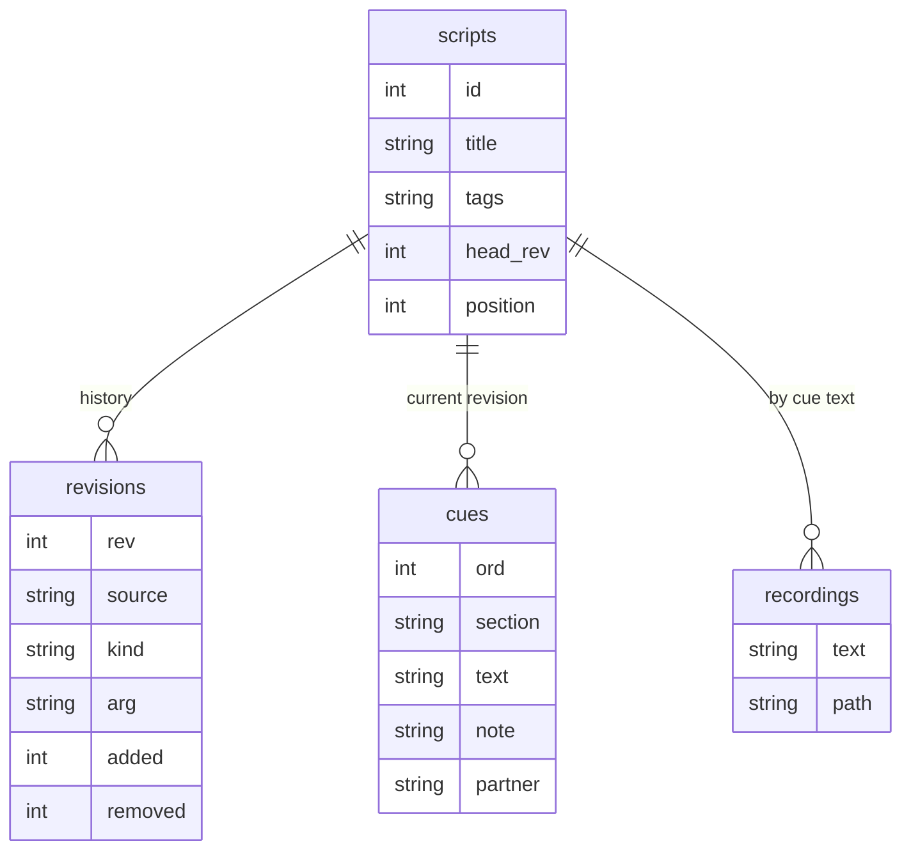

# Architecture

EarCue is a single-activity Android app. All state lives on the device; there is no server.

## Modules

| Package | Files | Role |
|---|---|---|
| `app.earcue` | `EarCueApp.kt`, `MainActivity.kt` | App singletons, import entry point, hardware key handling, per-app language |
| `app.earcue.audio` | `CueEngine.kt`, `Haptics.kt`, `Recorder.kt` | Playback, output guard, vibration patterns, own-voice recording |
| `app.earcue.data` | `Db.kt`, `ScriptParser.kt`, `Models.kt`, `Prefs.kt`, `DeckLayout.kt` | SQLite storage and history, script parsing, settings, button layouts |
| `app.earcue.overlay` | `OverlayService.kt` | Floating controls over other apps: foreground service and overlay window |
| `app.earcue.ui` | one file per screen, `Theme.kt`, `Components.kt`, `Deck.kt` | Jetpack Compose UI |

## Playback

`CueEngine` holds one `StateFlow<EngineState>` that every screen observes.

1. A press (touch deck, Sony shutter, volume key, earphone button) calls `next()`, `prev()` or `toggle()`.
2. `canPlay()` reads the output devices. Wired, USB, Bluetooth A2DP, LE Audio headsets and hearing aids count as earphones. With none, or with media volume at 0, the engine vibrates three times and stops there.
3. `silence()` stops the speech engine and any `MediaPlayer`, and bumps a generation counter so late callbacks from the old line are ignored.
4. The line plays from the user's recording if one exists, otherwise through `TextToSpeech.speak(QUEUE_FLUSH)`. `onRangeStart` callbacks drive the word highlight.
5. `ACTION_AUDIO_BECOMING_NOISY` and `AudioDeviceCallback` stop playback when earphones disconnect.

Buttons on the touch deck fire on touch-down, not on release, to save the 80–150 ms of a full tap.

## Floating controls

`OverlayService` is a foreground service of type `mediaPlayback`, since it keeps speech going into the earphones while another app is in front. It owns one `TYPE_APPLICATION_OVERLAY` window with `FLAG_NOT_FOCUSABLE`, so the app underneath keeps focus and key events, and touches outside the controls pass through.

- The window shows only while EarCue is in the background: `MainActivity` sets `EarCueApp.inForeground` in `onStart`/`onStop`, and the service follows that flow.
- The content is the Compose `OverlayPanel`, the same composable the settings screen uses for its live preview. Its buttons call `CueEngine.press()`/`release()`, so hold-to-skip and hold-to-restart work as on the deck.
- Dragging the grip moves the window with `WindowManager.updateViewLayout`; the position is clamped to the screen, saved on release, and re-clamped after rotation.
- The script text display is a second window with `FLAG_NOT_TOUCHABLE`: the current cue (with the spoken word lit) and up to four upcoming cues. Its position, size and text size come from settings. A second small touchable window, the handle, sits at its top-left corner: dragging it moves both windows and saves the position in % of the screen, and tapping it removes the text window until the next tap. Background and text opacity are separate settings; the window alpha is the higher of the two, each layer is scaled inside it, and the window alpha is capped at 0.8 because Android 12 and later block touches that pass through another app's overlay window above that opacity.
- Joined mode (`scriptAttach`) drops the handle and places the script window against the controls with `dockScript()` in `data/Dock.kt`: as wide as the controls (at least 260 dp), on the preferred side unless the other side has more room. It is recomputed whenever the controls move, change size or fold; when both are exactly as wide, their touching corners are squared off.
- Settings has a position and size editor: `OverlayEditor` draws `OverlayPanel` and `ScriptPane` at their real size, scaled down onto a mock screen with the real screen's aspect ratio, and maps drags back to screen pixels (panel) or screen percentages (script box).
- The service is started only from the foreground (turning the switch on, or opening EarCue with the switch on) and is not sticky. Hardware keys such as the Sony shutter go to the app in front. Earphone buttons do not reach EarCue either: speech is played by the TTS engine's own process, so Android never makes EarCue's `MediaSession` the media-button target while another app is in front.

## Storage and history

- Each import, update or restore appends a row to `revisions` with the full source text. Nothing is rewritten, the same model as a git commit log.
- `cues` holds the current revision only, expanded for fast playback.
- Restoring revision *n* appends a new revision with *n*'s source. Earlier and later revisions stay.
- Recordings are keyed by `(script, cue text)`, so a recorded line keeps its audio across revisions that contain the same text.
- Version 1 databases are migrated in `Db.onUpgrade`: existing scripts become revision 1.

## Localization

UI strings are generated from Python tables in `tools/i18n/` into `res/values*/strings.xml`. The generator fails if a language misses a key or changes a placeholder. Android 13 and later store the chosen language with `LocaleManager`. Older versions apply it in `MainActivity.attachBaseContext`.

## Themes

`Theme.kt` defines two palettes, Ink (dark) and Paper (light), behind a `CompositionLocal`. Stage mode always uses the dark palette on a black background at minimum brightness.
