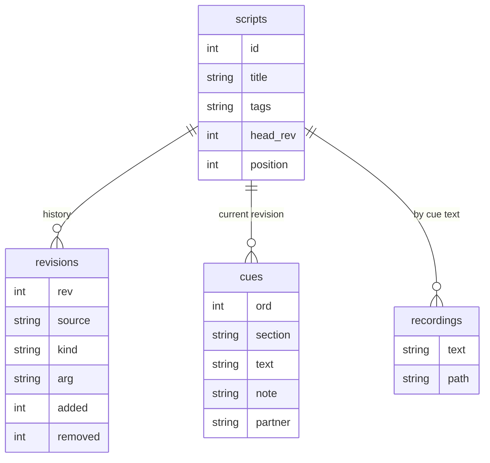

# Architecture

EarCue is a single-activity Android app. All state lives on the device; there is no server.

## Modules

| Package | Files | Role |
|---|---|---|
| `app.earcue` | `EarCueApp.kt`, `MainActivity.kt` | App singletons, import entry point, hardware key handling, per-app language |
| `app.earcue.audio` | `CueEngine.kt`, `Haptics.kt`, `Recorder.kt` | Playback, output guard, vibration patterns, own-voice recording |
| `app.earcue.data` | `Db.kt`, `ScriptParser.kt`, `Models.kt`, `Prefs.kt`, `DeckLayout.kt` | SQLite storage and history, script parsing, settings, button layouts |
| `app.earcue.ui` | one file per screen, `Theme.kt`, `Components.kt`, `Deck.kt` | Jetpack Compose UI |

## Playback

`CueEngine` holds one `StateFlow<EngineState>` that every screen observes.

1. A press (touch deck, Sony shutter, volume key, earphone button) calls `next()`, `prev()` or `toggle()`.
2. `canPlay()` reads the output devices. Wired, USB, Bluetooth A2DP, LE Audio headsets and hearing aids count as earphones. With none, or with media volume at 0, the engine vibrates three times and stops there.
3. `silence()` stops the speech engine and any `MediaPlayer`, and bumps a generation counter so late callbacks from the old line are ignored.
4. The line plays from the user's recording if one exists, otherwise through `TextToSpeech.speak(QUEUE_FLUSH)`. `onRangeStart` callbacks drive the word highlight.
5. `ACTION_AUDIO_BECOMING_NOISY` and `AudioDeviceCallback` stop playback when earphones disconnect.

Buttons on the touch deck fire on touch-down, not on release, to save the 80–150 ms of a full tap.

## Storage and history

- Each import, update or restore appends a row to `revisions` with the full source text. Nothing is rewritten, the same model as a git commit log.
- `cues` holds the current revision only, expanded for fast playback.
- Restoring revision *n* appends a new revision with *n*'s source. Earlier and later revisions stay.
- Recordings are keyed by `(script, cue text)`, so a recorded line keeps its audio across revisions that contain the same text.
- Version 1 databases are migrated in `Db.onUpgrade`: existing scripts become revision 1.

## Localization

UI strings are generated from Python tables in `tools/i18n/` into `res/values*/strings.xml`. The generator fails if a language misses a key or changes a placeholder. Android 13 and later store the chosen language with `LocaleManager`. Older versions apply it in `MainActivity.attachBaseContext`.

## Themes

`Theme.kt` defines two palettes, Ink (dark) and Paper (light), behind a `CompositionLocal`. Stage mode always uses the dark palette on a black background at minimum brightness.
