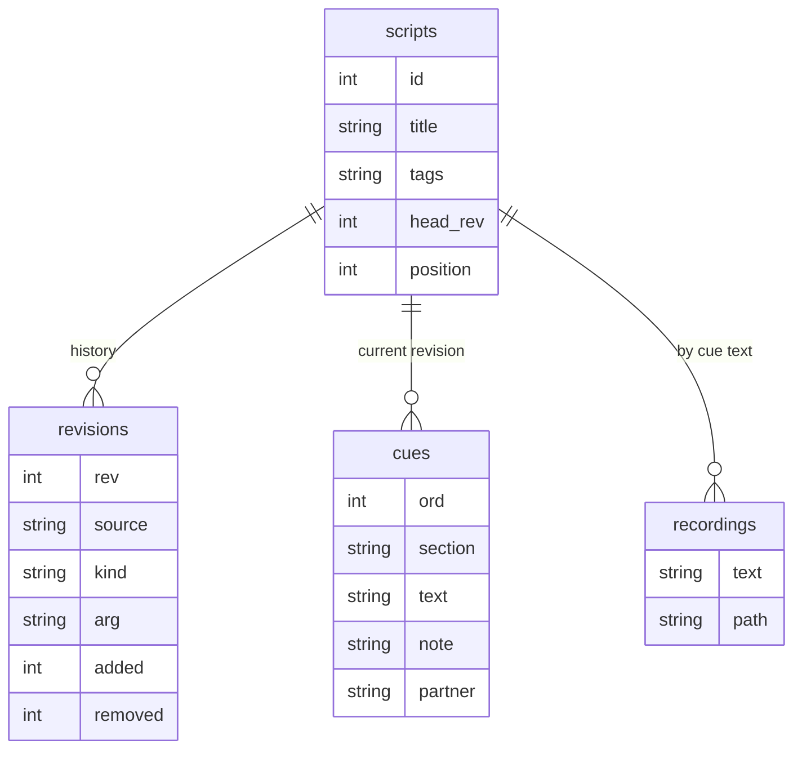

# 架構

EarCue 是單一 Activity 的 Android App，所有資料都存在手機上，沒有伺服器。

## 模組

| Package | 檔案 | 職責 |
|---|---|---|
| `app.earcue` | `EarCueApp.kt`、`MainActivity.kt` | App 單例、匯入入口、實體按鍵處理、App 個別語言 |
| `app.earcue.audio` | `CueEngine.kt`、`Haptics.kt`、`Recorder.kt` | 播放、輸出保護、震動節奏、自己的錄音 |
| `app.earcue.data` | `Db.kt`、`ScriptParser.kt`、`Models.kt`、`Prefs.kt`、`DeckLayout.kt` | SQLite 儲存與歷史、講稿解析、設定、按鍵配置 |
| `app.earcue.overlay` | `OverlayService.kt` | 在其他 App 上層的浮動控制：前景服務與浮動視窗 |
| `app.earcue.ui` | 每個畫面一個檔案、`Theme.kt`、`Components.kt`、`Deck.kt` | Jetpack Compose 介面 |

## 播放流程

`CueEngine` 只有一個 `StateFlow<EngineState>`，所有畫面都觀察它。

1. 按鍵（觸控面板、Sony 快門鍵、音量鍵、耳機按鍵）呼叫 `next()`、`prev()` 或 `toggle()`。
2. `canPlay()` 讀取輸出裝置。有線、USB、藍牙 A2DP、LE Audio 耳機與助聽器都算耳機。沒有耳機或媒體音量為 0 時，引擎強震三下就停止。
3. `silence()` 停止語音引擎與 `MediaPlayer`，並遞增世代計數器，讓舊句子的延遲回呼全部失效。
4. 有錄音就播錄音，否則用 `TextToSpeech.speak(QUEUE_FLUSH)`。`onRangeStart` 回呼驅動逐字高亮。
5. `ACTION_AUDIO_BECOMING_NOISY` 與 `AudioDeviceCallback` 會在耳機斷開時停止播放。

觸控面板的按鍵在手指按下時就觸發，不等放開，省下一次完整點擊的 80–150 毫秒。

## 浮動控制

`OverlayService` 是 `mediaPlayback` 類型的前景服務，因為其他 App 在前景時，它仍要把朗讀送進耳機。服務持有一個 `TYPE_APPLICATION_OVERLAY` 視窗，並設定 `FLAG_NOT_FOCUSABLE`：底下的 App 保有焦點與按鍵事件，控制區以外的觸控也會穿透過去。

- 視窗只在 EarCue 退到背景時顯示：`MainActivity` 在 `onStart`／`onStop` 設定 `EarCueApp.inForeground`，服務跟著這個 flow 顯示或隱藏。
- 內容是 Compose 的 `OverlayPanel`，設定畫面的即時預覽用的也是同一個元件。按鍵呼叫 `CueEngine.press()`／`release()`，所以按住連跳、按住重來都和主畫面一樣。
- 拖曳控點時用 `WindowManager.updateViewLayout` 移動視窗；位置限制在螢幕內，放開時儲存，旋轉後重新校正。
- 講稿文字展示是第二個視窗，設定 `FLAG_NOT_TOUCHABLE`：顯示目前片段（朗讀到的字會亮起）和最多四個接下來的片段。位置、大小和字級來自設定。左上角另有一個可觸控的小視窗當控點：拖曳它會同時移動兩個視窗，並以螢幕百分比儲存位置；點一下會移除文字視窗，再點一下恢復。背景和文字不透明度分開設定，視窗不透明度取兩者較高者，各層在視窗內再換算；視窗不透明度上限 0.8，因為 Android 12 起，觸控要穿過其他 App 的浮動視窗時，超過這個不透明度就會被擋下。
- 合為一體模式（`scriptAttach`）會拿掉控點，改用 `data/Dock.kt` 的 `dockScript()` 把講稿視窗貼在控制面板旁：寬度與面板相同（至少 260 dp），放在偏好的一側，除非另一側空間較大。面板移動、改變大小或收合時都會重新計算；兩者等寬時，相接的角改成直角。
- 設定裡有位置與大小編輯器：`OverlayEditor` 以實際尺寸繪製 `OverlayPanel` 和 `ScriptPane`，再縮小放到與實際螢幕同比例的模擬畫面上，拖曳量換算回螢幕像素（控制面板）或螢幕百分比（講稿框）。
- 服務只從前景啟動（打開開關，或開關已開時打開 EarCue），且不設為 sticky。Sony 快門鍵等實體按鍵會交給前景的 App。耳機按鍵同樣到不了 EarCue：朗讀由 TTS 引擎自己的行程播放，其他 App 在前景時，Android 不會把媒體按鍵交給 EarCue 的 `MediaSession`。

## 儲存與歷史

- 每次匯入、更新或回退都會在 `revisions` 新增一列，存完整原文。紀錄只增不改，與 git 的提交紀錄相同。
- `cues` 只放目前版本，展開後方便快速播放。
- 回退到第 *n* 版，會用 *n* 的內容新增一個版本；之前與之後的版本都保留。
- 錄音以「講稿＋句子文字」為鍵，所以同一句話在不同版本間會沿用同一段錄音。
- 第 1 版資料庫在 `Db.onUpgrade` 中遷移：既有講稿成為第 1 版。

## 多語系

介面字串由 `tools/i18n/` 的 Python 字串表產生成 `res/values*/strings.xml`。只要有語言缺少 key 或改動了參數，產生器就會報錯。Android 13 以上用 `LocaleManager` 保存所選語言；較舊版本在 `MainActivity.attachBaseContext` 套用。

## 主題

`Theme.kt` 定義兩套配色：Ink（深色）與 Paper（淺色），透過 `CompositionLocal` 提供。舞台模式不論主題，一律用深色配色、黑底與最低亮度。
