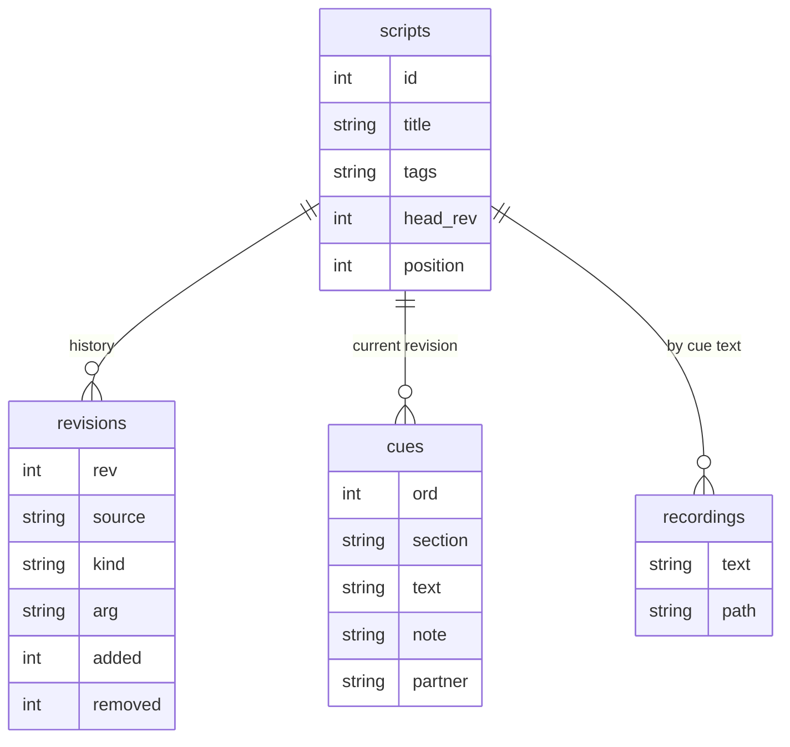

# 架構

EarCue 是單一 Activity 的 Android App，所有資料都存在手機上，沒有伺服器。

## 模組

| Package | 檔案 | 職責 |
|---|---|---|
| `app.earcue` | `EarCueApp.kt`、`MainActivity.kt` | App 單例、匯入入口、實體按鍵處理、App 個別語言 |
| `app.earcue.audio` | `CueEngine.kt`、`Haptics.kt`、`Recorder.kt` | 播放、輸出保護、震動節奏、自己的錄音 |
| `app.earcue.data` | `Db.kt`、`ScriptParser.kt`、`Models.kt`、`Prefs.kt`、`DeckLayout.kt` | SQLite 儲存與歷史、講稿解析、設定、按鍵配置 |
| `app.earcue.ui` | 每個畫面一個檔案、`Theme.kt`、`Components.kt`、`Deck.kt` | Jetpack Compose 介面 |

## 播放流程

`CueEngine` 只有一個 `StateFlow<EngineState>`，所有畫面都觀察它。

1. 按鍵（觸控面板、Sony 快門鍵、音量鍵、耳機按鍵）呼叫 `next()`、`prev()` 或 `toggle()`。
2. `canPlay()` 讀取輸出裝置。有線、USB、藍牙 A2DP、LE Audio 耳機與助聽器都算耳機。沒有耳機或媒體音量為 0 時，引擎強震三下就停止。
3. `silence()` 停止語音引擎與 `MediaPlayer`，並遞增世代計數器，讓舊句子的延遲回呼全部失效。
4. 有錄音就播錄音，否則用 `TextToSpeech.speak(QUEUE_FLUSH)`。`onRangeStart` 回呼驅動逐字高亮。
5. `ACTION_AUDIO_BECOMING_NOISY` 與 `AudioDeviceCallback` 會在耳機斷開時停止播放。

觸控面板的按鍵在手指按下時就觸發，不等放開，省下一次完整點擊的 80–150 毫秒。

## 儲存與歷史

- 每次匯入、更新或回退都會在 `revisions` 新增一列，存完整原文。紀錄只增不改，與 git 的提交紀錄相同。
- `cues` 只放目前版本，展開後方便快速播放。
- 回退到第 *n* 版，會用 *n* 的內容新增一個版本；之前與之後的版本都保留。
- 錄音以「講稿＋句子文字」為鍵，所以同一句話在不同版本間會沿用同一段錄音。
- 第 1 版資料庫在 `Db.onUpgrade` 中遷移：既有講稿成為第 1 版。

## 多語系

介面字串由 `tools/i18n/` 的 Python 字串表產生成 `res/values*/strings.xml`。只要有語言缺少 key 或改動了參數，產生器就會報錯。Android 13 以上用 `LocaleManager` 保存所選語言；較舊版本在 `MainActivity.attachBaseContext` 套用。

## 主題

`Theme.kt` 定義兩套配色：Ink（深色）與 Paper（淺色），透過 `CompositionLocal` 提供。舞台模式不論主題，一律用深色配色、黑底與最低亮度。
